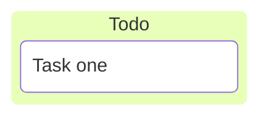

# goldmark-diagrams

A 100% pure-Go [Goldmark](https://github.com/yuin/goldmark) extension that compiles
fenced diagram and chart code blocks into a single, standardized, responsive,
CSS-interactive `<svg>` output, with optional `data-*` hooks for server-backed
interactivity (Kanban card moves, chart drill-downs).

See [`spec.md`](./spec.md) for the authoritative engineering specification.
Per-type guides and the contract reference live in
[`docs/`](./docs/README.md).

## Status

Implementing and covered by tests: the three engine adapters, the DOT and
PlantUML transpilers, the normalizer with its shared `data-*` hook vocabulary and
`--diagram-*` palette, the cache, the error cards, the reference stylesheet, and
golden fixtures for all twelve chart types, Kanban, Mindmap, Venn, Gantt,
GitGraph, flowchart and clustered flowchart, D2 ERD, PlantUML
sequence/gantt/mindmap, and Graphviz DOT, including the `mmd`, `echarts`,
`puml` and `graphviz` alias fences.

## Core constraints

1. **Pure Go only** (`CGO_ENABLED=0`). No CGo, no WASM/wazero, no external CLI
   binaries (`mmdc`, `plantuml.jar`, `dot`), no Node/Java runtimes, no headless browsers.
2. **Single `<svg>` output contract.** Every supported fenced block renders into a
   normalized `<figure class="svg-diagram">` wrapping an inline `<svg viewBox="...">`.
   Never emits `<canvas>`, ``, or inline `<script>`.
3. **Never-fail markdown conversion.** Invalid syntax or layout timeouts never
   break `markdown.Convert()`; errors render into an inline styled `<svg>` error card.
4. **CSS-first interactivity.** SVGs emit predictable `data-*` attributes and
   `--diagram-*` CSS custom properties so hover dimming, animated flow lines, and
   dark/light theming work in pure CSS.

## Engines

| Fence language | Parser / preprocessor | Engine |
| --- | --- | --- |
| `mermaid`, `mmd` | pass-through | `pele-go` (33 Mermaid types) |
| `d2` | pass-through | `terrastruct/d2` (dagre layout) |
| `plantuml`, `puml` | `PlantUMLToD2()` / `PlantUMLToMermaid()` | `terrastruct/d2`, or `pele-go` for gantt and mindmap |
| `dot`, `graphviz` | `DotToD2()` | `terrastruct/d2` |
| `chart`, `echarts` | JSON / YAML | `go-analyze/charts` (SVG painter) |

## Usage

```go
import (
	"bytes"

	"github.com/yuin/goldmark"
	diagrams "github.com/goldmark-diagrams/goldmark-diagrams"
)

md := goldmark.New(goldmark.WithExtensions(diagrams.New()))

var buf bytes.Buffer
_ = md.Convert([]byte("```mermaid\nflowchart TD\n  A --> B\n```"), &buf)
```

Fence info strings accept `key=value` attributes, which are stamped onto the
`<figure>` as `data-*` (`id=brd_123` becomes `data-id="brd_123"`):

````

````

Standalone rendering, for backend endpoints that re-render an interactive SVG
after a database mutation:

```go
html, err := diagrams.RenderStandalone(ctx, "mermaid", kanbanSyntax, diagrams.WithID("brd_123"))
```

Serve the reference stylesheet at your own route:

```go
css := diagrams.DefaultCSS() // GET /_diagrams/css
```

### Options

| Option | Default |
| --- | --- |
| `WithTheme("auto"｜"light"｜"dark"｜"neutral")` | `auto` |
| `WithCache(cache)` | `NewMemoryLRU(512)` |
| `WithErrorMode(mode)` | `ErrorSVGCard` |
| `WithLanguages(langs...)` | every supported language |
| `WithTimeout(d)` | `5s` |
| `WithD2Layout("dagre")` | `dagre` (`elk` is rejected: it needs an external binary) |
| `WithID(id)` | unset |

`NewDiskCache(dir)` is also available for caches that survive restarts; each
entry is written to `<sha256>.svg` atomically.

### Server-SVG feedback loop

Every primary element of every diagram type is stamped with the same hook
vocabulary, so one client-side handler can address all of them and one
stylesheet can style all of them:

| Diagram | Hooks and classes |
| --- | --- |
| `mermaid`, `mmd` | `data-item` + `data-role` using pele's own ids; a connector pele gives no id is named after its two endpoints (e.g. `a1->b2`); the role follows pele's class (`node`, `edge`, `commit`, `task`, `lifeline`, `sankey-node`, ...) and is echoed as class `svg-<role>` |
| Mermaid XY chart | `data-item` (the x-axis category) + `data-series="0..7"` + `data-role="bar"`, `"point"` or `"line"`; classes `svg-bar`, `svg-point`, `svg-line` |
| Mermaid info | `data-item` (the rendered version text) + `data-role="version"`; class `svg-version` |
| `d2`, `dot`, `plantuml` | `data-item` + `data-role="shape"` (shape label) or `data-role="connection"` (named by its endpoints, e.g. `orders->users`); classes `svg-shape`, `svg-connection` |
| `chart`, `echarts` | `data-item` (the category label, or the 1-based category number when `labels` is absent) + `data-series="0..7"` + `data-role="mark"`; line series use `data-role="line"` named after the series; classes `svg-mark`, `svg-line`, `svg-series-0..7` |
| kanban | `data-column-id` + `data-role="column"`, `data-card-id` + `data-role="card"`; classes `svg-column`, `svg-card` |

A thin delegated listener reads those attributes off the clicked element, POSTs
the mutation, and swaps `figure.outerHTML` with the freshly rendered fragment, so
all state stays in your database rather than in client-side stores.

### One stylesheet for every diagram

`DefaultCSS()` declares a single `--diagram-*` palette (`--diagram-bg`, `--diagram-fg`,
`--diagram-muted`, `--diagram-border`, `--diagram-line`, `--diagram-surface`, `--diagram-surface-alt`,
`--diagram-accent`, `--diagram-series-0` … `--diagram-series-7`) and every engine's paint is
mapped onto it, keeping the engine's own colour as the `var()` fallback:

- Mermaid's `--pele-*` variables are aliased onto `--diagram-*`.
- D2's embedded palette rules are rewritten by role (`fill-N1..N7`, `fill-B*`).
- Chart marks are rewritten to `var(--diagram-series-N, <engine colour>)`.

So one override themes all of them, and the dark palette follows
`prefers-color-scheme` or an explicit `data-theme="dark"` on the fence:

```css
.svg-diagram { --diagram-accent: #7c3aed; --diagram-series-0: #7c3aed; }
```

## Repository layout

```
goldmark-diagrams/
├── diagrams.go              # public API only: options, New(), RenderStandalone(), DefaultCSS()
├── e2e.sh                   # bash entry point: fixtures through the built container
├── Dockerfile               # shared caddy-* build template for the container image
├── cmd/goldmark-diagrams/   # stdin Markdown -> stdout HTML container entry point
├── assets/diagrams.css      # embedded reference CSS (//go:embed)
├── docs/                    # per-type guides plus the contract reference
├── testdata/                # input fixtures and golden HTML output
└── pkg/
    ├── render/              # pipeline: config, normalizer, figure, error card, renderFragment
    ├── extender/            # goldmark.Extender, ASTTransformer, HTML node renderer
    ├── cache/               # SHA-256 key, MemoryLRU and DiskCache
    ├── engines/
    │   ├── router.go        # dispatches lang -> pele-go, d2, or go-analyze/charts
    │   ├── pele.go          # pele-go SVG adapter
    │   ├── d2.go            # terrastruct/d2 SVG adapter
    │   ├── charts.go        # go-analyze/charts SVG adapter
    │   └── transpilers/
    │       ├── plantuml.go  # PlantUML -> D2, and gantt/mindmap -> Mermaid
    │       └── dot.go       # Graphviz DOT -> D2
    ├── tests/               # end-to-end API and golden tests
    └── docscheck/           # documentation coverage and render tests
```

## Development

The end-to-end suite runs through the built container image, not a Go test
process. `e2e.sh` builds the image from the Dockerfile, feeds every fixture in
`testdata/input` through it as a Markdown fence, and diffs the HTML against
`testdata/golden`:

```sh
./e2e.sh                 # build the image and verify every fixture
UPDATE_GOLDEN=1 ./e2e.sh # rewrite the golden fixtures from container output
```

The unit and API suite still runs in the builder image, never on the host:

```sh
docker run --rm -v caddy-sf-mod:/mod -v "$PWD":/src -w /src \
  -e GOMODCACHE=/mod -e GOCACHE=/mod/gocache -e CGO_ENABLED=0 \
  caddy:2.11.9-builder-alpine \
  sh -c 'go vet -buildvcs=false ./... && go test -buildvcs=false ./...'
```

Requires Go 1.26+ (`pele-go` mandates it); the builder image ships Go 1.27.

## License

Not yet specified.
