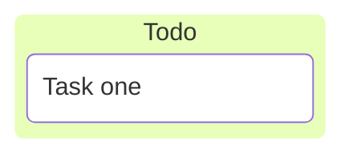

# Getting started

`goldmark-diagrams` is a pure-Go Goldmark extension that turns fenced diagram
and chart blocks into one normalized, responsive `<svg>`. It has no CGo, WASM,
Node, Java, or external-binary dependencies, so it builds with `CGO_ENABLED=0`.

## Requirements

- Go 1.26+ (pele-go mandates it).
- `CGO_ENABLED=0` must build clean.

## Install

```sh
go get github.com/frinknet/goldmark-diagrams
```

## Wire the extension into Goldmark

```go
package main

import (
	"bytes"

	diagrams "github.com/frinknet/goldmark-diagrams"
	"github.com/yuin/goldmark"
)

func main() {
	md := goldmark.New(goldmark.WithExtensions(diagrams.New()))

	var buf bytes.Buffer
	src := []byte("```mermaid\nflowchart TD\n  A --> B\n```\n")
	if err := md.Convert(src, &buf); err != nil {
		panic(err)
	}
	print(buf.String())
}
```

`New()` accepts `Option`s for theme, cache, error mode, languages, and timeout.
See [API](./api.md).

## Fence languages

| Fence language | Preprocessor | Engine |
| --- | --- | --- |
| `mermaid`, `mmd` | none | pele-go |
| `d2` | none | terrastruct/d2 (dagre) |
| `plantuml`, `puml` | PlantUML transpiler | D2, or pele-go for gantt and mindmap |
| `dot`, `graphviz` | DOT transpiler | terrastruct/d2 |
| `chart`, `echarts` | JSON / YAML spec | go-analyze/charts |

`SupportedLanguages()` returns exactly: `mermaid`, `mmd`, `d2`, `plantuml`,
`puml`, `dot`, `graphviz`, `chart`, `echarts`. Anything else is left as an
ordinary code block.

## Fence attributes

The info string accepts `key=value` pairs after the language. Each pair is
stamped on the `<figure>` as `data-<key>`, so `id=brd_123` becomes
`data-id="brd_123"` and `resource=orders` becomes `data-resource="orders"`.
Double-quoted values may contain spaces.

````

````

## Serve the stylesheet

The package ships a reference stylesheet. Serve it from your own route:

```go
css := diagrams.DefaultCSS() // e.g. GET /_diagrams/css
```

See [Theming](./theming.md).

## Render one diagram standalone

For backend endpoints that re-render after a mutation:

```go
html, err := diagrams.RenderStandalone(ctx, "mermaid", source, diagrams.WithID("brd_123"))
```

See [Interactivity](./interactivity.md).

## Output contract

Each fence yields exactly one `<figure class="svg-diagram" data-lang
data-engine data-theme data-hash [data-<attr>]>` wrapping one inline `<svg
viewBox="..." class="svg-diagram-svg" role="img" aria-label="...">`. The package
never emits `<canvas>`, ``, or inline `<script>`.

## See also

- [Hooks](./hooks.md)
- [Theming](./theming.md)
- [Interactivity](./interactivity.md)
- [Errors](./errors.md)
- [Caching](./caching.md)
- [API](./api.md)
- [D2](./languages/d2.md)
- [Graphviz DOT](./languages/dot.md)
- [PlantUML](./languages/plantuml.md)
