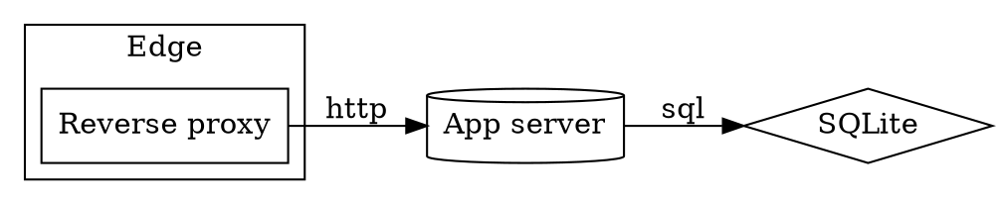

# Graphviz DOT

`dot` and `graphviz` fences are translated to D2 by `DotToD2` and rendered by
the pure-Go dagre engine. The `<figure>` reports `data-lang="dot"` and
`data-engine="d2"`.

## Example

````

````

## Supported subset

| DOT construct | Handling |
| --- | --- |
| `digraph` / `graph` | graph kind / container |
| `subgraph cluster_*` | D2 container labelled by the subgraph |
| `rankdir=LR` | layout direction |
| `node [shape=...]` | default shape for the scope |
| `a -> b` / `a -- b` | directed / undirected D2 connection |
| edge `[label="..."]` | connection label |
| `//`, `#`, `/* */` comments | discarded |
| `\n` inside quoted strings | real newline |
| `label=...`, `shape=box/cylinder/diamond/...` | D2 label and shape |

## Hooks

Shapes and connections carry the shared D2 hooks, `data-role="shape"` /
`data-role="connection"` with classes `svg-shape` / `svg-connection`. See
[D2](./d2.md) and [Hooks](../hooks.md).

## Limits

DOT support is a transliteration, not a full Graphviz implementation: only the
constructs in the table are translated. `record`/HTML labels, edge ports, and
multi-rank tricks are not claimed. Known gaps are tracked in
[`../../BACKLOG.md`](../../BACKLOG.md).

## See also

- [Getting started](../getting-started.md)
- [D2](./d2.md)
- [PlantUML](./plantuml.md)
- [Hooks](../hooks.md)
