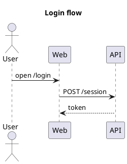
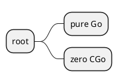

# PlantUML

`plantuml` and `puml` fences run through the PlantUML transpiler. `@startgantt`
and `@startmindmap` sources are translated to Mermaid and rendered by pele-go;
every other form is translated to D2. The `<figure>` reports
`data-lang="plantuml"` and the engine that actually rendered it
(`data-engine="pele"` for gantt/mindmap, `data-engine="d2"` otherwise).

## Routing

| Source marker | Path |
| --- | --- |
| `@startgantt` | `PlantUMLToMermaid` → pele-go |
| `@startmindmap` | `PlantUMLToMermaid` → pele-go |
| `@startuml` (sequence, class, component, state, use-case, ...) | `PlantUMLToD2` → D2 |
| bare source (no marker) | `PlantUMLToD2` → D2 |

## Examples

Sequence (to D2):

````

````

Gantt (to pele/Mermaid):

````
```plantuml
@startgantt
Project starts 2024-01-01
[Design] lasts 10 days
[Build] starts after [Design]
@endgantt
```
````

Mindmap (to pele/Mermaid):

````

````

## Golden fixtures

| Form | Fixture |
| --- | --- |
| Sequence (D2) | `testdata/input/sequence.plantuml` |
| Gantt (`puml` alias, pele) | `testdata/input/gantt-plantuml.puml` |
| Mindmap (`puml` alias, pele) | `testdata/input/mindmap-plantuml.puml` |

## Hooks

- Gantt and mindmap output carries pele's Mermaid roles (`task`, `node`; see
  [Hooks](../hooks.md)).
- Every D2 form carries `data-role="shape"` / `data-role="connection"` with the
  `svg-shape` / `svg-connection` classes.

## Limits

The transpiler covers a subset of PlantUML: declaration keywords, grouping
blocks (`alt`/`opt`/`loop`/`par`/...), and sequences are handled; unsupported
statements are skipped.

## See also

- [Getting started](../getting-started.md)
- [D2](./d2.md)
- [Graphviz DOT](./dot.md)
- [Hooks](../hooks.md)
