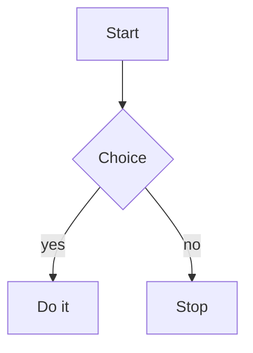
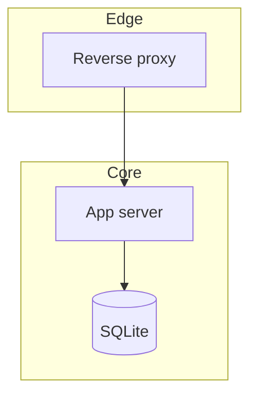

# Flowchart

A flowchart draws a graph of steps, decisions and their connections, opened with the `flowchart` keyword (the legacy `graph` alias also works).

| | |
| --- | --- |
| Fence | ` ```mermaid ` (alias ` ```mmd `) |
| Engine | pele-go |
| Keyword | `flowchart` |
| Golden fixture | `testdata/input/flowchart.mermaid`; clustered: `testdata/input/flowchart-clusters.mmd` |

## Example



## Clusters

A `subgraph` becomes a group carrying `data-item` + `data-role="cluster"` (class
`svg-cluster`); the nodes and edges inside it keep their own hooks.



## Output

One `<figure class="svg-diagram" data-lang="mermaid" data-engine="pele" data-theme="auto" data-hash="...">` around one inline `<svg viewBox="..." class="svg-diagram-svg" role="img">`. Nodes carry `data-item` + `data-role="node"` (class `svg-node`); edges carry `data-item` + `data-role="edge"` (class `svg-edge`); clusters carry `data-item` + `data-role="cluster"` (class `svg-cluster`). Stamped groups get a `<title>` child for zero-JS hover tooltips.

## Theming

Nodes and edges read the shared palette — `--diagram-surface`, `--diagram-border`, `--diagram-fg`, `--diagram-line`, `--diagram-accent` — because pele's `--pele-*` variables are aliased onto `--diagram-*` on the root `<svg>`. Without `DefaultCSS()` pele's own colours are the `var()` fallback.

## Caveats

An unsupported construct renders the 600x120 `svg-diagram-error` card instead of breaking conversion; only `ErrorFail` makes `Markdown.Convert()` return an error.
