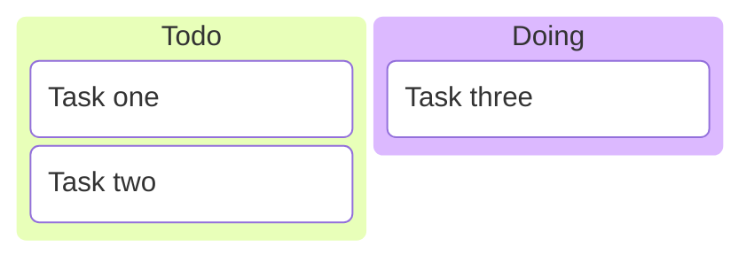

# Kanban

A kanban board groups cards into columns, opened with the `kanban` keyword; it is the type wired for the server-SVG feedback loop.

| | |
| --- | --- |
| Fence | ` ```mermaid ` (alias ` ```mmd `) |
| Engine | pele-go |
| Keyword | `kanban` |
| Golden fixture | `testdata/input/kanban.mermaid` |

## Example



## Output

One `<figure class="svg-diagram" data-lang="mermaid" data-engine="pele" data-theme="auto" data-hash="...">` around one inline `<svg viewBox="..." class="svg-diagram-svg" role="img">`. Columns carry `data-column-id` + `data-role="column"` (class `svg-column`); cards carry `data-card-id` + `data-role="card"` (class `svg-card`). Stamped groups get a `<title>` child for zero-JS hover tooltips.

## Theming

Columns, cards and their borders read the shared palette — `--diagram-surface`, `--diagram-surface-alt`, `--diagram-border`, `--diagram-fg`, `--diagram-accent` — because pele's `--pele-*` variables are aliased onto `--diagram-*` on the root `<svg>`. Without `DefaultCSS()` pele's own colours are the `var()` fallback.

## Caveats

An unsupported construct renders the 600x120 `svg-diagram-error` card instead of breaking conversion; only `ErrorFail` makes `Markdown.Convert()` return an error.
