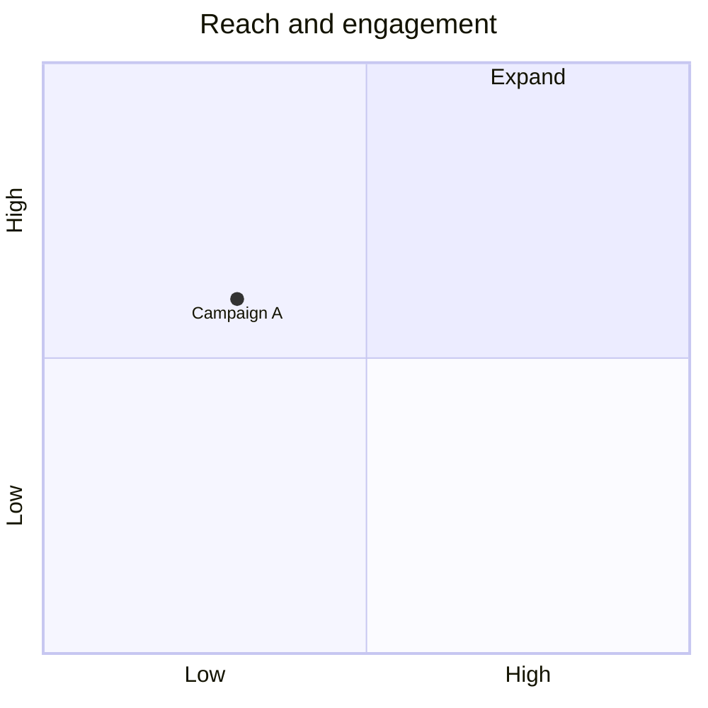

# Quadrant chart

A quadrant chart plots points against two axes split into four named quadrants, opened with the `quadrantChart` keyword.

| | |
| --- | --- |
| Fence | ` ```mermaid ` (alias ` ```mmd `) |
| Engine | pele-go |
| Keyword | `quadrantChart` |
| Golden fixture | none yet |

## Example



## Output

One `<figure class="svg-diagram" data-lang="mermaid" data-engine="pele" data-theme="auto" data-hash="...">` around one inline `<svg viewBox="..." class="svg-diagram-svg" role="img">`. Elements pele marks with its own id get `data-item` and a `data-role` taken from pele's own class, echoed as a class `svg-<role>`; drawing primitives nested inside a stamped item are not stamped again. Stamped groups also get a `<title>` child for zero-JS hover tooltips.

## Theming

Quadrant backgrounds, the plotted points and their labels read the shared palette — `--diagram-surface`, `--diagram-surface-alt`, `--diagram-border`, `--diagram-fg`, `--diagram-accent` — because pele's `--pele-*` variables are aliased onto `--diagram-*` on the root `<svg>`. Without `DefaultCSS()` pele's own colours are the `var()` fallback.

## Caveats

An unsupported construct renders the 600x120 `svg-diagram-error` card instead of breaking conversion; only `ErrorFail` makes `Markdown.Convert()` return an error.

> Coverage: no golden fixture yet; see `BACKLOG.md`.
