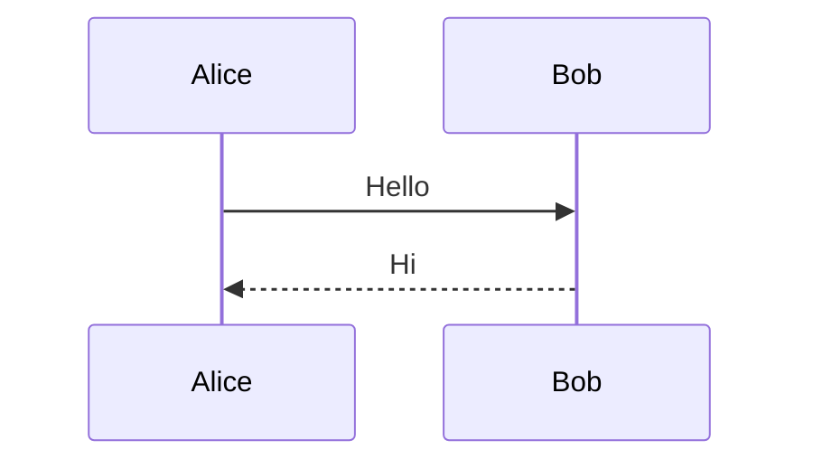

# Sequence

A sequence diagram shows messages exchanged between participants over time; the fence opens with the Mermaid keyword `sequenceDiagram`.

| | |
| --- | --- |
| Fence | ` ```mermaid ` (alias ` ```mmd `) |
| Engine | pele-go |
| Keyword | `sequenceDiagram` |
| Golden fixture | none yet |

## Example



## Output

One `<figure class="svg-diagram" data-lang="mermaid" data-engine="pele" data-theme="auto" data-hash="...">` wraps a single inline `<svg viewBox="…" class="svg-diagram-svg" role="img">`. Elements pele marks with its own id get `data-item` plus a `data-role` taken from pele's own class, and the role is repeated as an `svg-<role>` class; stamped groups that hold text also gain a `<title>` child for zero-JS hover tooltips.

## Theming

Shapes paint through pele's `--pele-*` custom properties, which `pkg/render/normalizer.go` aliases onto the shared palette (`--pele-bg` to `--diagram-surface`, `--pele-border` to `--diagram-border`, `--pele-accent` to `--diagram-accent`, and so on), keeping pele's colour as the `var()` fallback. Without `DefaultCSS()` the `--diagram-*` names are undefined and pele's own colours apply.

## Caveats

- An unsupported construct renders the 600x120 `svg-diagram-error` card instead of failing `markdown.Convert()`; only `ErrorFail` mode returns an error.
- A connector pele gives no id is named after the two items its path joins (`source->target`).

> Coverage: no golden fixture yet.
