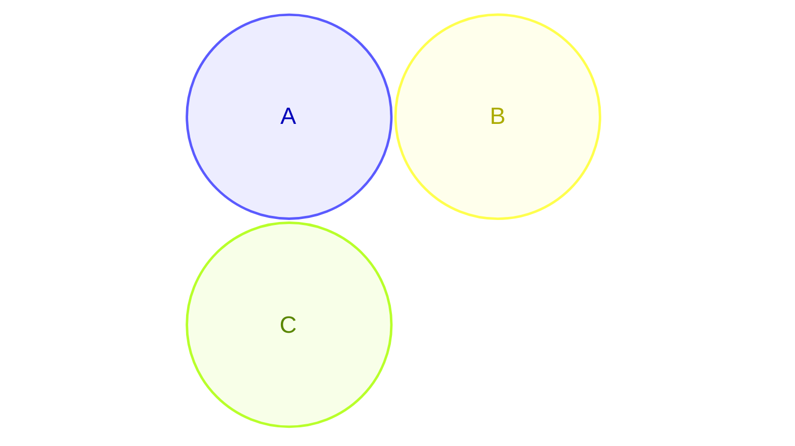

# Venn

A Venn diagram shows sets and the regions where they overlap, opened with the `venn-beta` keyword.

| | |
| --- | --- |
| Fence | ` ```mermaid ` (alias ` ```mmd `) |
| Engine | pele-go |
| Keyword | `venn-beta` |
| Golden fixture | `testdata/input/venn.mermaid` |

## Example



## Output

One `<figure class="svg-diagram" data-lang="mermaid" data-engine="pele" data-theme="auto" data-hash="...">` around one inline `<svg viewBox="..." class="svg-diagram-svg" role="img">`. Sets carry `data-item` + `data-role="venn-set"` (class `svg-venn-set`); overlap regions carry `data-item` + `data-role="venn-region"` (class `svg-venn-region`). Stamped groups get a `<title>` child for zero-JS hover tooltips.

## Theming

Set circles, overlap regions and labels read the shared palette — `--diagram-surface`, `--diagram-border`, `--diagram-fg`, `--diagram-accent` — because pele's `--pele-*` variables are aliased onto `--diagram-*` on the root `<svg>`. Without `DefaultCSS()` pele's own colours are the `var()` fallback.

## Caveats

An unsupported construct renders the 600x120 `svg-diagram-error` card instead of breaking conversion; only `ErrorFail` makes `Markdown.Convert()` return an error. Venn connectors have no per-connection hook: pele qualifies an edge only when it exposes an id, and venn connectors do not (see `BACKLOG.md`).
